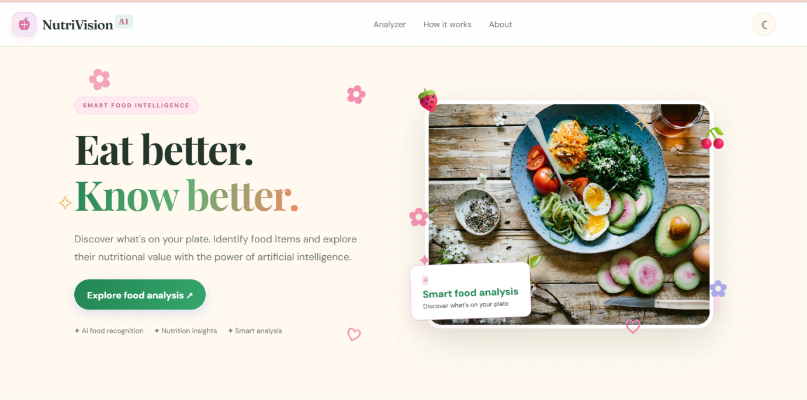

# 🍎 NutriVision AI
### AI-Based Food Quality and Nutrition Estimation

NutriVision AI is a machine learning-based web application designed to estimate the nutritional values of food from uploaded images.

The main objective of this project is not only to recognize food items but also to provide approximate nutritional information such as calories, protein, carbohydrates, fat, and fibre based on the selected serving size.

## ✨ Features

- **AI-Based Food Recognition:** Predicts food categories from uploaded images.
- **Nutrition Estimation:** Provides approximate calories, protein, carbohydrates, fat, and fibre.
- **Serving Size Calculator:** Adjusts nutritional values according to the selected serving size.
- **Top-3 Predictions:** Displays the three most likely food categories.
- **Image Quality Analysis:** Checks image brightness and sharpness.
- **Interactive Website:** Includes image upload, drag-and-drop, preview, and light/dark themes.

## 🛠️ Technologies Used

- Python
- Flask
- HTML
- CSS
- JavaScript
- PyTorch
- Torchvision
- Scikit-learn
- OpenCV
- NumPy
- Joblib

## 📊 Dataset Information

**Dataset:** Food-101

Food-101 is a food image dataset containing 101 food categories and 101,000 images.

For this project, a subset of 100 images per category was selected.

- Total selected images: 10,100
- Training images: 8,080
- Testing images: 2,020
- Train-test split: 80:20
- Data splitting: Stratified sampling

The dataset was used to extract image features and train machine learning classification models.

## 🧠 Methodology and Algorithms

The project uses a feature extraction and classification approach.

### 1. Feature Extraction – ResNet50

A pretrained ResNet50 model was used as a feature extractor.

- The final classification layer was removed.
- The network extracts 2048-dimensional feature vectors from food images.
- L2 normalization was applied to the extracted features.

### 2. Machine Learning Classification Algorithms

Three machine learning algorithms were implemented and evaluated:

**1. Support Vector Machine (SVM)**
- Uses an RBF kernel.
- Helps classify food images based on extracted features.
- Tuned using C = 10 and gamma = scale.

**2. K-Nearest Neighbors (KNN)**
- Uses 5 nearest neighbors.
- Uses distance-based weighting and cosine distance.
- Classifies images based on similarity between feature vectors.

**3. Decision Tree**
- Uses a tree-based classification approach.
- Maximum depth: 40.
- Minimum samples per leaf: 2.
- Balanced class weights were used.

### 3. Model Evaluation

The models were evaluated using classification metrics such as:

- Accuracy
- Precision
- Recall
- F1-score

### 4. Final Model Selection

After evaluating the three classical algorithms (with SVM achieving the best baseline among them), a **fine-tuned ResNet34 model (`best_nutrivision_model.pt`)** trained on the full 101 Food-101 classes was selected as the primary model for the NutriVision AI website due to its significantly higher accuracy.

## 📈 Experimental Results

The fine-tuned **ResNet34** model achieved the following results on the Food-101 test dataset (improving over the earlier **55.69%** accuracy / **55.39%** Macro F1-score SVM baseline):

| Evaluation Metric | Result |
|---|---:|
| Accuracy | **84.27%** |
| Macro Precision | **84.37%** |
| Macro Recall | **84.27%** |
| Macro F1-score | **84.26%** |

## 🥗 Nutrition Estimation

After predicting the food category, the application retrieves approximate nutritional values from a predefined nutrition reference dictionary.

The nutritional information includes:

- Calories (kcal)
- Protein (g)
- Carbohydrates (g)
- Fat (g)
- Fibre (g)

Values are stored per 100 grams and adjusted according to the user's selected serving size.

**Note:** Nutrition values are approximate reference-based estimates, not direct measurements from the image. Prediction and nutrition availability depend on the supported food categories.

## 🖼️ Screenshots

Screenshots of the working application are included below.

### 1. Home Page


### 2. Food Image Upload


### 3. Food Prediction and Nutrition Results


### 4. Serving Size and Nutrition Estimation


## 🚀 How to Run the Project

### Step 1: Clone the repository

```bash
git clone [https://github.com/Kuheli18/NutriVision-AI.git](https://github.com/Kuheli18/NutriVision-AI.git)