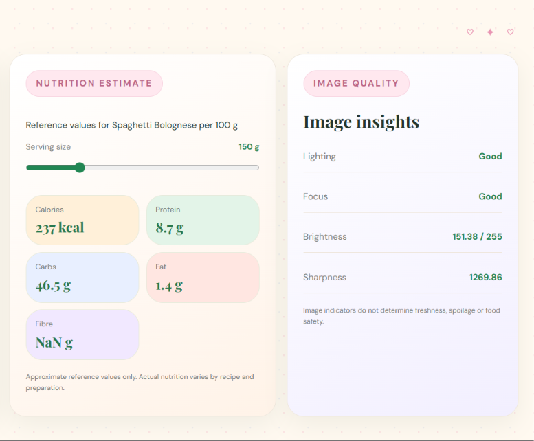

# 🍎 NutriVision AI
### AI-Based Food Quality and Nutrition Estimation

NutriVision AI is a machine learning-based web application designed to estimate the nutritional values of food from uploaded images.

The main objective of this project is not only to recognize food items but also to provide approximate nutritional information such as calories, protein, carbohydrates, fat, and fibre based on the selected serving size.

## ✨ Features

- **AI-Based Food Recognition:** Predicts food categories from uploaded images across 101 dishes.
- **Nutrition Estimation:** Provides approximate calories, protein, carbohydrates, fat, and fibre.
- **Serving Size Calculator:** Adjusts nutritional values according to the selected serving size.
- **Top-3 Predictions:** Displays the three most likely food categories with confidence scores.
- **Image Quality Analysis:** Checks image brightness and sharpness.
- **Interactive Website:** Includes image upload, drag-and-drop, preview, and light/dark themes.

## 🛠️ Technologies Used

- Python
- Flask
- HTML
- CSS
- JavaScript
- PyTorch
- Torchvision
- Scikit-learn
- OpenCV
- NumPy
- Joblib

## 📊 Dataset Information

**Dataset:** Food-101

Food-101 is a benchmark food image dataset containing **101 food categories** and **101,000 images** (1,000 images per category).

- **Training images:** 75,750 (750 per category)
- **Testing images:** 25,250 (250 per category)
- **Preprocessing:** Resize to 256 px, center crop to 224×224 px, and ImageNet normalization

## 🧠 Methodology and Algorithms

The project evolved from classical machine learning baselines to end-to-end deep transfer learning.

### 1. Baseline Experiments (Feature Extraction + Classical ML)

Initially, a pretrained **ResNet50** backbone (with the final classification layer removed) was used to extract 2048-dimensional L2-normalized feature vectors on a stratified 10,100-image subset, evaluated across three classifiers:

- **Support Vector Machine (SVM):** RBF kernel (`C = 10`, `gamma = scale`) — best classical baseline (**55.69%** accuracy, **55.39%** Macro F1-score)
- **K-Nearest Neighbors (KNN):** 5 nearest neighbors with cosine distance weighting
- **Decision Tree:** Maximum depth 40, minimum samples per leaf 2, balanced class weights

### 2. Final Model – Fine-Tuned ResNet34

To significantly improve classification accuracy across all 101 food categories, a **ResNet34** convolutional neural network was fine-tuned end-to-end on the full Food-101 dataset.

- Replaced the final fully connected layer with a 101-class linear classifier
- Saved the best checkpoint as `best_nutrivision_model.pt` for inference in the Flask backend

### 3. Model Evaluation

The models were evaluated using standard multi-class classification metrics:

- Accuracy
- Macro Precision
- Macro Recall
- Macro F1-score

## 📈 Experimental Results

The fine-tuned **ResNet34** model achieved the following results on the Food-101 test dataset (improving over the earlier **55.69%** accuracy / **55.39%** Macro F1-score SVM baseline):

| Evaluation Metric | Result |
|---|---:|
| Accuracy | **84.27%** |
| Macro Precision | **84.37%** |
| Macro Recall | **84.27%** |
| Macro F1-score | **84.26%** |

## 🥗 Nutrition Estimation

After predicting the food category, the application retrieves approximate nutritional values from a predefined nutrition reference dictionary covering all 101 Food-101 categories.

The nutritional information includes:

- Calories (kcal)
- Protein (g)
- Carbohydrates (g)
- Fat (g)
- Fibre (g)

Values are stored per 100 grams and adjusted according to the user's selected serving size.

**Note:** Nutrition values are approximate reference-based estimates, not direct measurements from the image.

## 🖼️ Screenshots

Screenshots of the working application are included below.

### 1. Home Page


### 2. Food Image Upload


### 3. Food Prediction and Nutrition Results


### 4. Serving Size and Nutrition Estimation


## 🚀 How to Run the Project

### Step 1: Clone the repository

```bash
git clone [https://github.com/Kuheli18/NutriVision-AI.git](https://github.com/Kuheli18/NutriVision-AI.git)