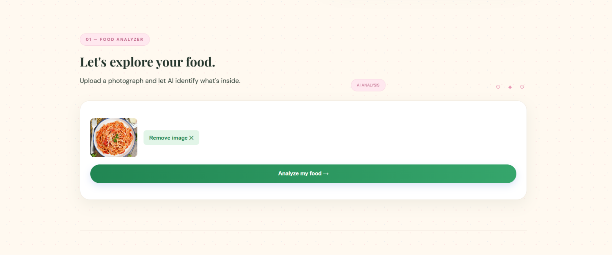
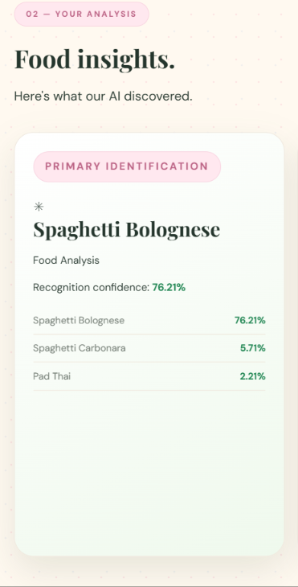

# 🍎 NutriVision AI
### AI-Based Food Quality and Nutrition Estimation

NutriVision AI is a machine learning-based web application designed to estimate the nutritional values of food from uploaded images.

The main objective of this project is not only to recognize food items but also to provide approximate nutritional information such as calories, protein, carbohydrates, fat, and fibre based on the selected serving size.

## ✨ Features

- **AI-Based Food Recognition:** Predicts food categories from uploaded images.
- **Nutrition Estimation:** Provides approximate calories, protein, carbohydrates, fat, and fibre.
- **Serving Size Calculator:** Adjusts nutritional values according to the selected serving size.
- **Top-3 Predictions:** Displays the three most likely food categories.
- **Image Quality Analysis:** Checks image brightness and sharpness.
- **Interactive Website:** Includes image upload, drag-and-drop, preview, and light/dark themes.

## 🛠️ Technologies Used

- Python
- Flask
- HTML
- CSS
- JavaScript
- PyTorch
- Torchvision
- Scikit-learn
- OpenCV
- NumPy
- Joblib

## 📊 Dataset Information

**Dataset:** Food-101

Food-101 is a food image dataset containing 101 food categories and 101,000 images.

For this project, a subset of 100 images per category was selected.

- Total selected images: 10,100
- Training images: 8,080
- Testing images: 2,020
- Train-test split: 80:20
- Data splitting: Stratified sampling

The dataset was used to extract image features and train machine learning classification models.

## 🧠 Methodology and Algorithms

The project uses a feature extraction and classification approach.

### 1. Feature Extraction – ResNet50

A pretrained ResNet50 model was used as a feature extractor.

- The final classification layer was removed.
- The network extracts 2048-dimensional feature vectors from food images.
- L2 normalization was applied to the extracted features.

### 2. Machine Learning Classification Algorithms

Three machine learning algorithms were implemented and evaluated:

**1. Support Vector Machine (SVM)**
- Uses an RBF kernel.
- Helps classify food images based on extracted features.
- Tuned using C = 10 and gamma = scale.

**2. K-Nearest Neighbors (KNN)**
- Uses 5 nearest neighbors.
- Uses distance-based weighting and cosine distance.
- Classifies images based on similarity between feature vectors.

**3. Decision Tree**
- Uses a tree-based classification approach.
- Maximum depth: 40.
- Minimum samples per leaf: 2.
- Balanced class weights were used.

### 3. Model Evaluation

The models were evaluated using classification metrics such as:

- Accuracy
- Precision
- Recall
- F1-score

### 4. Final Model Selection

After evaluating the three algorithms, **Support Vector Machine (SVM) was selected as the final model** for the NutriVision AI website because it achieved the best performance among the evaluated models.

The trained SVM model is saved as `best_svm.pkl` and is used by the Flask backend for food prediction.

## 📈 Experimental Results

The final SVM model achieved the following results on the test dataset:

| Evaluation Metric | Result |
|---|---:|
| Accuracy | **55.69%** |
| Macro F1-score | **55.39%** |

These results represent the experimental evaluation of the trained SVM model on the selected Food-101 subset.

The SVM model was selected over KNN and Decision Tree based on the comparative evaluation.

## 🥗 Nutrition Estimation

After predicting the food category, the application retrieves approximate nutritional values from a predefined nutrition reference dictionary.

The nutritional information includes:

- Calories (kcal)
- Protein (g)
- Carbohydrates (g)
- Fat (g)
- Fibre (g)

Values are stored per 100 grams and adjusted according to the user's selected serving size.

**Note:** Nutrition values are approximate reference-based estimates, not direct measurements from the image. Prediction and nutrition availability depend on the supported food categories.

## 🖼️ Screenshots

Screenshots of the working application are included below.

### 1. Home Page


### 2. Food Image Upload


### 3. Food Prediction and Nutrition Results


### 4. Serving Size and Nutrition Estimation


## 🚀 How to Run the Project

### Step 1: Clone the repository

```bash
git clone https://github.com/Kuheli18/NutriVision-AI.git
```

### Step 2: Open the project folder

```bash
cd NutriVision-AI
```

### Step 3: Install dependencies

```bash
pip install -r requirements.txt
```

### Step 4: Ensure the trained model files are available

Place the required model files inside the `models` folder:

- `best_svm.pkl`
- `food_classes.pkl`

The trained model files must be obtained from the project's model files or training workflow if they are not included in the repository.

### Step 5: Run the application

```bash
python server.py
```

### Step 6: Open in your browser

```text
http://127.0.0.1:5000
```

## 📁 Project Structure

```text
NutriVision-AI/
│
├── models/
│   ├── best_svm.pkl
│   └── food_classes.pkl
│
├── static/
│   ├── script.js
│   └── style.css
│
├── templates/
│   └── index.html
│
├── screenshots/
│   ├── homepage.png
│   ├── upload.png
│   ├── results.png
│   └── nutrition.png
│
├── server.py
├── requirements.txt
├── .gitignore
└── README.md
```

## ⚠️ Limitations

- The food classifier is trained on a selected subset of Food-101.
- It can only predict categories included in its training classes.
- Nutrition values are approximate and depend on the predefined reference database.
- The estimated nutrition may differ from actual values depending on ingredients, preparation methods, and portion size.

## 🔮 Future Improvements

- Expand food recognition to include more fruits and vegetables.
- Improve classification accuracy with larger and more diverse datasets.
- Use more detailed nutrition databases.
- Improve nutrition estimation using food segmentation and portion-size estimation.

## 👩‍💻 Developed By

**Kuheli Adhikari**

B.Tech – Computer Science and Engineering (AI & ML)

Ghani Khan Choudhury Institute of Engineering and Technology

---

**Project:** NutriVision AI – AI-Based Food Quality and Nutrition Estimation
